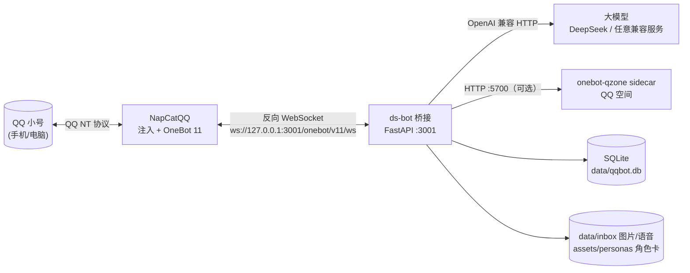

# ds-bot · 把 AI 接进 QQ

> 一个跑在 Windows 上的 QQ 个人号机器人：**收消息、发消息、发图 / 表情包、听语音、看图片、写 QQ 空间**，
> 背后是任意 OpenAI 兼容的大模型（默认 DeepSeek），带角色卡、长期记忆、情绪与生活线。

<p align="center">
  
  
  
  
</p>

---

## 这是什么

`ds-bot` 是「AI 人格 + QQ」的胶水层：

- **协议端**：[NapCatQQ](https://github.com/NapNeko/NapCatQQ) 给官方 QQ NT 客户端做注入，翻译成 OneBot 11（不需要签名服务器、不需要改协议）
- **桥接**：Python + FastAPI（`qqbot/`），对外提供 REST 与 SSE，对内维护消息库、记忆、情绪、日程
- **大脑**：任何 **OpenAI 兼容的 Chat Completions** 服务（默认 DeepSeek），换 base_url / model 即可换成别的
- **可选外挂**：QQ 空间（onebot-qzone）、本地语音识别（SenseVoice）、表情包库、识图（视觉模型 + NapCat OCR）

它不是客服机器人，是一个「像人一样聊天」的框架：会分条说话、记得你说过的事、有自己的日程和情绪、
按喜好收藏表情包、偶尔主动戳你一下、会自己发说说（都要你手动打开）。

## 功能一览

| 能力 | 说明 | 文档 |
| --- | --- | --- |
| 收发消息 | 私聊/群聊，文本、图片、语音、表情包、@、回复、戳一戳 | [OneBot 接口表](docs/RESEARCH.md) |
| 自动回复 | 私聊白名单 / 所有好友；静默去抖、分条发送、防复读、可补话 | [CONFIG](docs/CONFIG.md) |
| 角色卡 | `assets/personas/*.md` 多张卡热切换，记忆 / 情绪 / 生活线按角色隔离 | [PERSONAS](docs/PERSONAS.md) |
| 记忆 | 30 条上下文 + **当天备忘**（随聊随压）+ 事实/情节记忆 + 每日日结，按人隔离 | [MIND](docs/MIND.md) |
| 情绪与生活 | 三维情绪会漂会回落；每天生成日程，15 分钟一拍推进生活事件 | [MIND](docs/MIND.md) |
| 识图 | 图片/表情包先 OCR + 视觉模型描述，再进对话 | [VISION](docs/VISION.md) |
| 听语音 | SILK 解码 + SenseVoice 本地转写，带语气提示 | [ASR](docs/ASR.md) |
| 表情包 | 好友发来的表情包按喜好收藏，聊天时按概率发出去 | [STICKERS](docs/STICKERS.md) |
| 主动行为 | 戳一戳、自主发说说、刷好友空间、点赞评论（默认关闭） | [PROACTIVE](docs/PROACTIVE.md) |
| QQ 空间 | 发说说、看好友动态、点赞评论（需要 onebot-qzone sidecar） | [PROACTIVE](docs/PROACTIVE.md) |
| 个人主页 | 自己写个性签名（头像只读，不给她改） | [PROFILE](docs/PROFILE.md) |

## 架构



## 快速开始

> 完整步骤（含 NapCat 安装、扫码登录、反向 WS 配置、排错）见 **[docs/SETUP.md](docs/SETUP.md)**。
> 这里是最短路径。

### 0. 准备

- Windows 10/11（本机实测 Windows + Python 3.14，理论 3.10+）
- 一个**专用 QQ 小号**（不要用主号；有封号风险，见「安全与合规」）
- [NapCatQQ](https://github.com/NapNeko/NapCatQQ)（推荐用 OneKey 安装器）
- 一个大模型 API Key（默认 DeepSeek：<https://platform.deepseek.com>）

### 1. 装依赖

```powershell
git clone https://github.com/LUOBO-D/ds-bot.git
cd ds-bot
python -m venv .venv
.\.venv\Scripts\python.exe -m pip install -r requirements.txt
```

### 2. 配置

```powershell
copy .env.example .env
notepad .env
```

最少改这几项：

```ini
DEEPSEEK_API_KEY=sk-你的key
AUTO_REPLY_ALLOWLIST=10001        # 你自己的 QQ 号；写 * 表示所有好友
```

### 3. 起 NapCat 并登录小号

用 NapCat OneKey 安装器装好后启动，扫码登录小号，然后在 **WebUI（默认 `http://127.0.0.1:6099`）**
添加一个 **WebSocket 客户端**：

```
地址：ws://127.0.0.1:3001/onebot/v11/ws
消息格式：array
```

### 4. 起桥接

**推荐：一条命令全起（NapCat + QQ 空间 sidecar + 桥接）**

```powershell
.\start-all.bat                 # 已经在跑的会自动跳过
.\start-all.ps1 -CheckOnly      # 只看端口状态，不启动
```

`start-all` 会：① 端口 6099 没监听时拉起 `napcat-qq\start-napcat.bat -q <账号>`；② 5700 没监听时拉起 `services\onebot-qzone`；③ 前台启动桥接并打印管理 token。停止用 `.\stop-all.bat`（加 `-WithQQ` 连 QQ 一起关）。

也可以只起桥接：

```powershell
.\start.ps1
# 或：$env:PYTHONUTF8=1; .\.venv\Scripts\python.exe run.py
```

看到 `gateway connected (self_id=...)` 就说明通了。验证：

```powershell
curl -H "Authorization: Bearer <ADMIN_TOKEN>" http://127.0.0.1:3001/api/state
```

`ADMIN_TOKEN` 在 `.env` 里（首次启动留空会自动生成）。

> 空间功能报 502 / Cookie 过期时，跑一次：
> ```powershell
> .venv\Scripts\python.exe scripts\refresh_qzone_cookie.py --restart
> ```
> 它会从 NapCat 重新取 qzone Cookie 写进 `.qzone\cookies.json`，并重启 sidecar，不用扫码。

### 5. 跟她说话

用你的 QQ 私聊这个机器人小号即可。默认角色是「小鲸鱼」（可在 `.env` 改 `PERSONA_DEFAULT`），也可以切换：
在 QQ 里发 `角色列表` / `切换角色 小鲸鱼`。

## 接入你自己的 API

所有模型调用都走 **OpenAI 兼容的 `/chat/completions`**，改 `.env` 三项就能换供应商，**不用改代码**：

```ini
DEEPSEEK_API_KEY=<你的 key>
DEEPSEEK_BASE=https://api.deepseek.com      # 换成你的服务地址，例如 https://api.openai.com/v1
DEEPSEEK_MODEL=deepseek-chat                # 换成你的模型名，例如 gpt-4o-mini
```

### 常见组合

| 服务 | `DEEPSEEK_BASE` | `DEEPSEEK_MODEL` | 备注 |
| --- | --- | --- | --- |
| DeepSeek | `https://api.deepseek.com` | `deepseek-chat` | 默认；识图也用 `deepseek-chat` |
| OpenAI | `https://api.openai.com/v1` | `gpt-4o-mini` | 识图把 `VISION_MODEL` 设成同款多模态模型 |
| 通义千问（兼容模式） | `https://dashscope.aliyuncs.com/compatible-mode/v1` | `qwen-plus` | 识图可换 `qwen-vl-max` |
| 月之暗面 | `https://api.moonshot.cn/v1` | `moonshot-v1-8k` | |
| 本地 Ollama | `http://127.0.0.1:11434/v1` | `qwen2.5:14b` | key 随便填 |
| 自建 vLLM / LiteLLM | `http://127.0.0.1:8000/v1` | 你的模型 | |

### 换成别的模型时要注意

1. **识图**：`VISION_MODEL` 必须是支持图片输入的多模态模型，否则 `.env` 里设 `VISION_ENABLED=0`。
   本机实测：DeepSeek 家只有 `deepseek-chat` 能吃图（`deepseek-flash` 会因推理 token 吃满而返回空）。
2. **JSON 输出**：记忆反思、日结、表情包打分都要求模型输出 JSON。小模型可能不听话，
   表现是记忆不增长 / 日志里 `empty memo`，换大一点的模型即可。
3. **上下文长度**：一次回复约注入 2~4k tokens（人设 + 记忆 + 当天备忘 + 生活线 + 30 条历史），
   模型上下文至少 8k 比较稳。
4. **并发**：`BRAIN_MAX_CONCURRENCY` 控制同时调用数，超过会在队列里等（`BRAIN_QUEUE_TIMEOUT` 秒后放弃）。

## 常用接口

所有接口都要 `Authorization: Bearer <ADMIN_TOKEN>`。

| 方法 | 路径 | 作用 |
| --- | --- | --- |
| GET | `/api/state` | 网关 / 数据库 / 各子系统状态 |
| GET | `/api/account` | 机器人 QQ 信息 |
| GET | `/api/friends` · `/api/groups` | 好友 / 群列表 |
| POST | `/api/send/text` | 发文本 |
| POST | `/api/send/image` | 发图片（本地路径 / URL / base64） |
| POST | `/api/send/sticker` | 发表情（face_id / 本地图片 / 表情库 id / 标签） |
| POST | `/api/poke` | 戳一戳 |
| POST | `/api/chat` | 只生成回复、不发送（调试用） |
| POST | `/api/chat/send` | 生成并真的发出去 |
| GET/POST | `/api/personas` | 角色列表 / 切换 |
| GET | `/api/mind` | 情绪 + 生活线 + 心跳 + 记忆一步看全 |
| GET/POST | `/api/memory/memo` | 当天备忘（查看 / 手动压缩） |
| GET | `/api/events` | SSE 事件流 |

完整路由见 `qqbot/main.py`。

## 目录结构

```
ds-bot/
├─ qqbot/                 # 桥接服务（核心）
│  ├─ main.py             # FastAPI 入口 + 全部 REST 路由
│  ├─ onebot.py           # OneBot 11 客户端（反向 WS / HTTP）
│  ├─ autoreply.py        # 自动回复：去抖、上下文、发送、反思
│  ├─ brain.py            # 大模型调用与提示词装配
│  ├─ personas.py         # 多角色卡
│  ├─ memory.py           # 记忆：检索 / 反思 / 当天备忘 / 日结
│  ├─ emotion.py          # 三维情绪
│  ├─ life.py             # 日程与生活事件
│  ├─ keeper.py           # 后台心跳
│  ├─ proactive.py        # 戳一戳 / 自主说说
│  ├─ social.py           # QQ 空间：刷动态 / 点赞 / 评论
│  ├─ vision.py           # 识图（OCR + 视觉模型）
│  ├─ asr.py              # 语音转写（SenseVoice / Paraformer）
│  ├─ stickers.py         # 表情包库
│  ├─ profile.py          # 个人主页（签名；头像只读）
│  ├─ store.py            # SQLite
│  └─ tools.py            # 发送、查询、限速
├─ assets/
│  ├─ personas/           # 角色卡（*.md）+ active.json
│  └─ stickers/manifest.json
├─ docs/                  # 设计与使用文档
├─ scripts/               # 安装 / 基准 / 空间 Cookie 刷新脚本
├─ tests/                 # 假网关 + e2e
├─ run.py                 # 启动入口
├─ start.ps1              # 只启动桥接
├─ start-all.ps1/.bat     # 一键启动：NapCat + 空间 sidecar + 桥接
├─ stop-all.ps1/.bat      # 一键停止
├─ requirements.txt
└─ .env.example
```

## 安全与合规

- **不要用主号**：个人号接第三方协议端有被风控 / 封号的风险，请用专用小号并控制频率。
- **不要提交 `.env`**：里面是 API key、`ADMIN_TOKEN`、空间 Cookie。
- 桥接默认只监听 `127.0.0.1`，**不要**直接暴露到公网；要远程用请套 VPN / 反向代理并加鉴权。
- `/api/napcat/cookies` 会返回 QQ 登录态 Cookie，等价于账号凭据，只在本机调用。
- QQ 空间接口来自非官方途径，随时可能失效；请遵守平台规则，不要批量刷屏、不要爬取他人数据。
- 这是个人自用项目，不提供任何形式的账号安全保证。

## 文档

- [docs/SETUP.md](docs/SETUP.md) —— 从零安装（NapCat / 扫码 / 反向 WS / 排错）
- [docs/CONFIG.md](docs/CONFIG.md) —— 全部环境变量与调参说明
- [docs/PERSONAS.md](docs/PERSONAS.md) —— 角色卡怎么写、怎么切换、记忆如何隔离
- [docs/CHARACTER.md](docs/CHARACTER.md) —— 示例角色「沈知微」完整设定
- [docs/MIND.md](docs/MIND.md) —— 记忆 / 情绪 / 生活线设计
- [docs/VISION.md](docs/VISION.md) · [docs/ASR.md](docs/ASR.md) · [docs/STICKERS.md](docs/STICKERS.md) —— 识图 / 语音 / 表情包
- [docs/PROACTIVE.md](docs/PROACTIVE.md) —— 主动戳戳、自主说说、空间互动
- [docs/RESEARCH.md](docs/RESEARCH.md) —— 生态选型调研（为什么是 NapCat）

## 致谢

- [NapCatQQ](https://github.com/NapNeko/NapCatQQ) —— QQ 协议端
- [onebot-qzone](https://github.com/Gu-Heping/onebot-qzone) —— QQ 空间 sidecar
- [sherpa-onnx](https://github.com/k2-fsa/sherpa-onnx) / [SenseVoice](https://github.com/FunAudioLLM/SenseVoice) —— 本地语音识别
- [silk-v3-decoder](https://github.com/kn007/silk-v3-decoder) —— SILK 解码

## License

[MIT](LICENSE)
